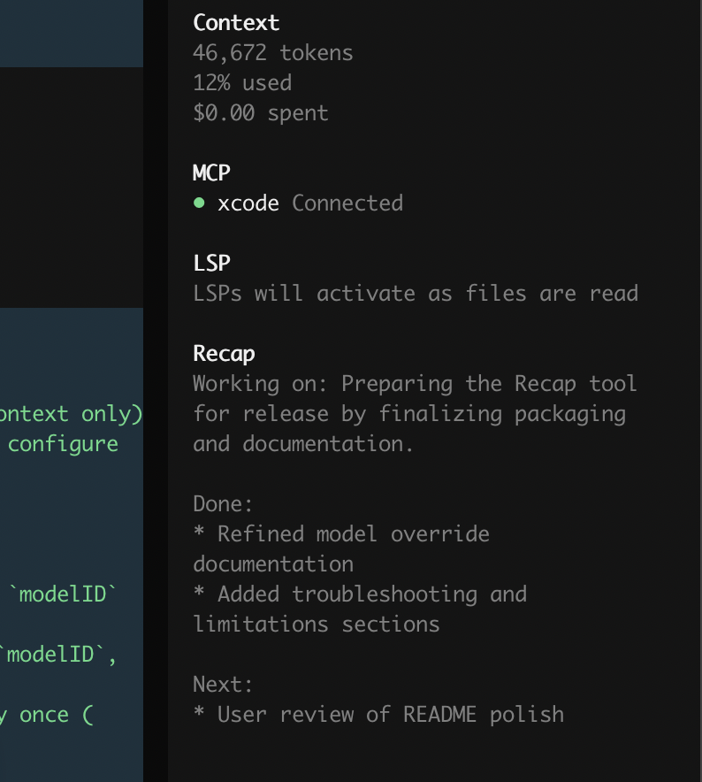

# opencode-recap

One-click Markdown session recap in the OpenCode sidebar.

- Click **Recap** to generate a short summary
- Stays in the sidebar (does not pollute the chat thread)
- Auto-clears after 3 new prompts to keep it fresh



## Install

Requires OpenCode 2.0 or newer.

```sh
opencode plugin add craig-dougan-maersk/opencode-recap
```

Project-only: add `"craig-dougan-maersk/opencode-recap"` to `plugins` in `opencode.jsonc`.

### Collapsed by default

The panel starts collapsed so the sidebar stays quiet; click the header arrow to expand it. Pass the option as `false` to start expanded:

```jsonc title="opencode.jsonc"
{
  "plugins": [
    { "package": "craig-dougan-maersk/opencode-recap", "options": { "collapsedByDefault": true } }
  ]
}
```

## Usage

Open a session and click **Recap** in the sidebar.

What the plugin does internally:

- Uses the most recent 10 messages as recap context
- Reuses previous recap output for continuity
- Generates the recap with a one-off text generation request (no extra session is created)

## Model selection

By default, recap uses the session's most recent assistant model.

You can override it by setting both `providerID` and `modelID` in the plugin options in `opencode.jsonc`:

```json
{
  "plugins": [
    {
      "package": "craig-dougan-maersk/opencode-recap",
      "options": {
        "providerID": "github-copilot",
        "modelID": "gemini-3-flash-preview"
      }
    }
  ]
}
```

## Troubleshooting

- `ProviderModelNotFoundError`: verify values with `opencode models`
- `Invalid recap plugin config`: set both fields or neither
- `duplicate tui plugin id`: configure recap only once

## Credits

Derived from [streetturtle/opencode-better-sidebar](https://github.com/streetturtle/opencode-better-sidebar) (MIT), split into a standalone repository so OpenCode can install it directly.
